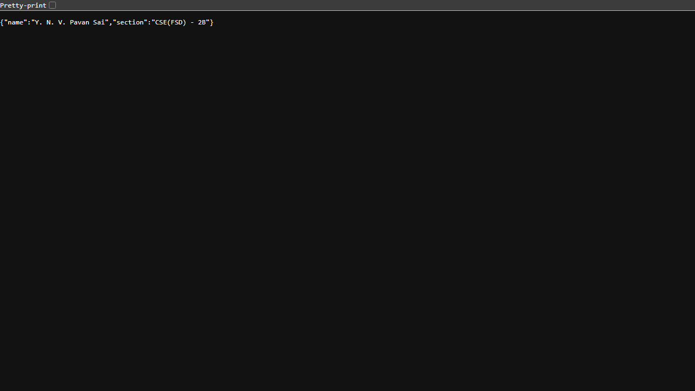
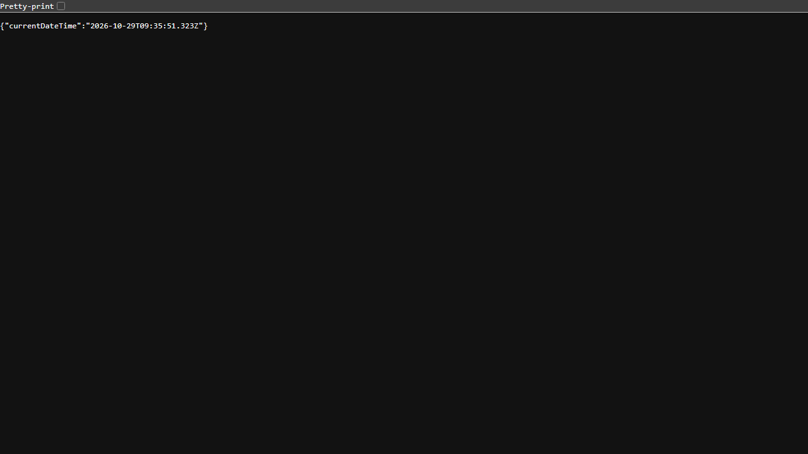

# Lab 1: Node.js and Express Server

## Student Details

- **Name:** Y. N. V. Pavan Sai
- **Registration Number:** 252U1R7099
- **Section:** CSE(FSD) - 2B
- **Course:** Backend Development Fundamentals
- **Lab Number:** 01

## Live Link

- **Deployment Status:** Local environment deployment. Remote deployment is pending external cloud provider configuration and deployment authorization. The server is configured with `process.env.PORT || 3000` to bind to any platform-provided port automatically.

## Objective

To set up a Node.js project, understand `package.json` and project metadata, create a basic HTTP server using the built-in `http` module, and build an Express server handling multiple routes with proper HTTP status codes.

## Technologies Used

- **Node.js** (v24.x)
- **Express.js** (v5.x)
- **JavaScript**
- **npm** (Node Package Manager)
- **Visual Studio Code**

## Project Structure

```text
lab-01/
├── screenshots/
│   ├── home.png
│   ├── about.png
│   ├── time.png
│   └── not-found.png
├── server-http.js
├── server.js
├── package.json
├── package-lock.json
├── .gitignore
└── README.md
```

## Package Configuration (`package.json`)

The `package.json` file serves as the manifest for the Node.js project. Key fields include:

- **`name`**: The unique identifier/name of the project (`lab-01`).
- **`version`**: The current semantic version of the application (`1.0.0`).
- **`main`**: The primary entry point file of the application (`server.js`).
- **`scripts`**: Command aliases to run common tasks (e.g., `"start": "node server.js"`, `"start:http": "node server-http.js"`).
- **`dependencies`**: Production libraries required by the application (e.g., `"express"`).

## Installation and Setup

### Prerequisites

- Node.js (v18 or higher recommended) and npm installed
- Visual Studio Code or any modern code editor
- Web browser or API testing tool (such as curl or Postman)

### Steps to Run

1. Clone or navigate to the project directory:

   ```bash
   cd "Lab 1/lab-01"
   ```

2. Install the project dependencies:

   ```bash
   npm install
   ```

3. Start the Express server:

   ```bash
   node server.js
   ```

   *(Alternatively: `npm start`)*

4. Open your browser or API client and visit:

   `http://localhost:3000`

### How to Run the Basic HTTP Server

To test the server built using Node.js's native `http` module:

1. If the Express server is currently running, stop it by pressing `Ctrl + C` in the terminal to free port 3000.
2. Run the basic HTTP server:

   ```bash
   node server-http.js
   ```

   *(Alternatively: `npm run start:http`)*

3. Visit `http://localhost:3000` in your browser. The plain-text message `Hello` will be displayed.

## Endpoints

| Method | Endpoint | Description | Expected Status |
|---|---|---|---|
| GET | `/` | Returns a clear welcome message | 200 OK |
| GET | `/about` | Returns student name and section in JSON format | 200 OK |
| GET | `/time` | Returns the current date and time | 200 OK |
| GET | `/anything` | Unknown route demonstration (returns 404 error) | 404 Not Found |

> **Note:** The `/anything` path is an example demonstrating route fallback. Any undefined URL path returns a `404 Not Found` response.

## Screenshots

### 1. Home Route

Displays the welcome message.


### 2. About Route

Displays student name and section in JSON format.



### 3. Time Route

Displays the current date and time generated via `new Date()`.



### 4. Unknown Route

Displays the `404 - Page Not Found` response for undefined routes.


## HTTP Status Codes

- **`200 OK`**: Standard response indicating that the HTTP request was successfully received, understood, and processed.
- **`404 Not Found`**: Indicates that the server could not find the requested route or resource.

## Viva Questions and Answers

### 1. What is the difference between `package.json` and `node_modules`?

- **`package.json`**: A lightweight metadata and configuration file that records project details, entry points, scripts, and lists the names and version ranges of project dependencies.
- **`node_modules`**: The physical directory where npm downloads and stores all the installed packages and their transitive dependencies. It is much larger and should never be committed to source control.

### 2. What does `app.listen()` do?

`app.listen()` binds and listens for incoming HTTP connections on the specified host and port number. It starts the Node.js server loop so the application can receive and respond to network requests.

### 3. What do `request` and `response` represent?

- **`request` (`req`)**: An object containing information about the incoming HTTP request made by the client, including URL path, HTTP method, headers, parameters, query strings, and body data.
- **`response` (`res`)**: An object used by the server to construct and send the HTTP response back to the client, allowing the developer to set status codes, custom headers, and send data (HTML, JSON, plain text).

## Problems Faced and Solutions

1. **Port 3000 Conflict between servers**:
   - *Problem:* Attempting to run `node server.js` while `node server-http.js` was already running resulted in `EADDRINUSE: address already in use :::3000`.
   - *Solution:* Ensured that any running server instance was stopped (`Ctrl + C` or terminating the process) before starting another server that binds to the same port.

2. **Ensuring correct HTTP 404 status code**:
   - *Problem:* Returning a 404 error message using `res.send("404 - Page Not Found")` without explicitly specifying the status code would default to a `200 OK` HTTP header.
   - *Solution:* Used `response.status(404).send("404 - Page Not Found")` inside the fallback middleware to guarantee the proper HTTP status code is delivered.

## Git and Repository Notes

- The `.gitignore` file excludes `node_modules/` and `.env` from version control.
- `package-lock.json` is tracked to ensure reproducible dependency trees across environments.
- All endpoint screenshots are organized inside the `screenshots/` directory.
- Secrets, credentials, or personal sensitive tokens are strictly kept out of the repository.
